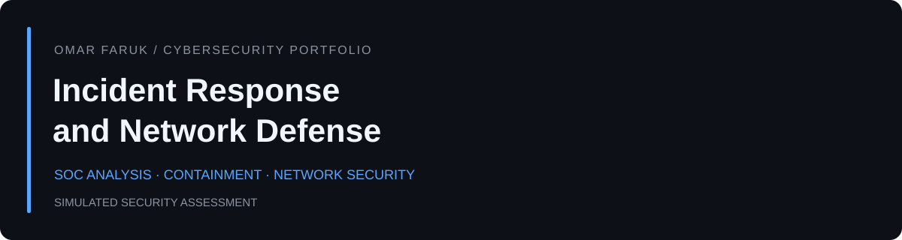

# Incident Response And Network Defense

  

Evaluated a simulated malware response and proposed verified containment, safe recovery, and enforceable network boundaries.

**[Read the full analysis](REPORT.md)** · **[View the formatted PDF](REPORT.pdf)** · **[Author profile](https://github.com/omar-faruk-cybersecurity)**

## Assessment at a glance

| Area | Summary |
| --- | --- |
| Setting | Fictional financial-services organization |
| My role | Security analyst conducting a written assessment |
| Method | Review supplied evidence, identify control gaps, explain risk, and recommend verification criteria |
| Main conclusion | Traffic recorded after reported isolation means containment must be investigated and verified before closure. |
| Delivery status | Analysis complete; recommended controls and tests are proposed |

## Key takeaway

> Traffic recorded after reported isolation means containment must be investigated and verified before closure.

## What this repository demonstrates

- Incident timeline and evidence interpretation
- Containment and recovery decision flow
- Segmentation and conceptual firewall policy
- Validation criteria and implementation tradeoffs

## Explore the deliverables

| File | Purpose |
| --- | --- |
| [REPORT.md](REPORT.md) | Complete analysis, recommendations, tradeoffs, and references |
| [REPORT.pdf](REPORT.pdf) | Formatted report for reading and sharing |
| [Decision flow](decision-flow.svg) | Proposed containment and recovery workflow |

## Approach

I distinguished observations from interpretations, identified where the evidence was incomplete, and connected each proposed control to the problem it addresses. The report includes priorities, accountable owners, and acceptance checks for a future implementation.

## Scope and background

This is a simulated portfolio assessment developed from Information Systems Security coursework at Western Governors University. Source exhibits, assignment instructions, and identifying details are excluded. The work demonstrates analysis and technical writing; deployment and measured remediation outcomes are outside its scope. Standards references appear in the full report.

---

**Omar Faruk** · [GitHub](https://github.com/omar-faruk-cybersecurity) · [LinkedIn](https://www.linkedin.com/in/omar-faruk-cybersecurity/)
