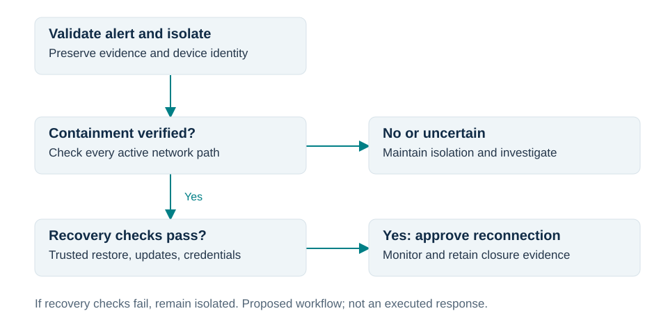

# Incident Response and Network Defense

**Author:** Omar Faruk  
**Project type:** Simulated incident review and defensive design

## Executive summary

A fictional financial-services organization detected suspicious outbound activity, isolated an HR workstation, and restored it from backup. Those actions were directionally appropriate, but later network alerts mean the available record does not demonstrate complete containment or verified recovery.

I recommend explicit containment and recovery gates, endpoint and network telemetry correlation, a separate zone for public services, enforced departmental boundaries, and restricted administrative access. Firewall policy should permit documented business flows and deny other traffic at the relevant enforcement points.

## Scope and analytical limits

The analysis uses the incident timeline, IDS event descriptions, architecture, and firewall policy summarized in the original paper. Raw logs, packet captures, endpoint images, device configurations, and complete network routes were not available for this portfolio review. Hostnames, addresses, and malware labels are omitted in favor of functional descriptions.

Times below are relative to the reported attachment opening. They preserve the analytical intervals without reproducing the dated source timeline. The source record's time synchronization has not been independently established. NIST SP 800-61 Rev. 3 provides the response and recovery framework used in the original assessment [1].

## Timeline and evidence interpretation

| Relative time | Reported event | Assessment |
| --- | --- | --- |
| T+0 | Employee opens an attachment associated with the incident | Starting event for the response review |
| T+36 to 38 minutes | IDS alert and timeline entry describe suspicious outbound activity | Useful detection, with a two-minute discrepancy between records |
| T+53 minutes | Workstation isolation is recorded | Approximately 15–17 minutes after reported detection |
| T+91 minutes | IDS describes SMB movement from the affected address toward Finance | Conflicts with treating the earlier isolation as verified containment |
| T+4 hours 31 minutes | Endpoint is restored from backup | Availability action; backup trust and endpoint validation are not established |
| Following morning | Suspicious DNS query appears from the same address | Requires investigation; it does not by itself prove reinfection |

The later traffic may reflect ineffective isolation, another interface, delayed event ingestion, timestamp problems, address reassignment, or another explanation. Resolve that question using original event and ingestion times, switch and EDR records, DHCP assignments, VPN activity, and endpoint identifiers. Do not assume every event sharing an IP address came from the same device.

An IDS label is an investigative lead. The record does not establish successful exploitation from a scan, successful data theft from suspected command-and-control traffic, or the identity of an attacker.

## Response improvements

**Verified containment.** Correlate the IDS alert with endpoint telemetry and assign an incident owner. Quarantine the endpoint, inspect wired, wireless, and VPN connectivity, and preserve a trusted management path where feasible. Record the isolation action and independently verify that unauthorized communication has stopped. Preserve relevant evidence before destructive recovery actions. This implements the containment objective discussed in NIST's RS.MI-01 outcome [1].

**Verified recovery.** Select restoration assets that predate the suspected compromise and verify their integrity and malware status. Restore in isolation, apply updates and current detections, investigate persistence, and address exposed credentials. Rebuild from trusted installation media if confidence in restoration cannot be established. Require incident-owner approval before production reconnection and monitor for recurring indicators. These steps reflect RC.RP-03 and RC.RP-05 [1].

The original organization-wide antivirus update occurred after the next-morning DNS event. That sequence supports requiring current protection before reconnection; it does not establish the cause of the DNS alert.

## Network design decisions

| Exposure | Recommended boundary | Security benefit and limit |
| --- | --- | --- |
| Public web and mail services lack a demonstrated internal boundary | Dedicated DMZ with restricted public ingress and explicit internal dependencies | Limits inward movement; a simplified diagram alone does not prove existing segmentation is absent |
| HR and Finance are on different subnets without demonstrated enforcement | Internal firewall or equivalent control on routed interdepartmental paths | Restricts unnecessary SMB and other movement; separate IP ranges alone do not enforce policy |
| Firewall administration accepts broadly sourced connections | Dedicated management zone reached through an approved jump host, named accounts, MFA, and encrypted management | Reduces management exposure; a port number alone does not establish encryption status |

Internal traffic needs enforcement and monitoring on its actual route. An internet-edge firewall cannot control traffic that bypasses it. These design decisions apply boundary protection and default-deny principles in NIST SP 800-53 SC-7 and SC-7(5) [2].

## Conceptual firewall policy

This table expresses policy intent, not executable configuration. Exact objects, routing, state handling, application dependencies, and platform evaluation semantics require validation before deployment. Approved narrow permits must precede the corresponding default denials in an ordered rule base.

| Source | Destination | Service or purpose | Action |
| --- | --- | --- | --- |
| Internet | Public DMZ services | Approved HTTPS and mail delivery only | Permit and monitor |
| Approved administrative path | Management interfaces | Approved encrypted management services | Permit and log |
| Approved internal clients | Internal DNS resolvers and controlled web proxy | Required name resolution and web access | Permit and monitor |
| Approved application sources | Specific internal dependencies | Documented service flows only | Permit and log as required |
| Other sources | Internal zones | Unapproved traffic at each relevant boundary | Deny and log |
| Internal zones | External destinations | Traffic outside approved egress paths and exceptions | Deny and log |

Remove superseded broad permits so they cannot bypass the new policy. Preserve legitimate stateful return traffic and terminate established malicious sessions as part of containment. Test business services before activation and retain a rollback path.

Controlled DNS and web egress reduce direct command-and-control opportunities, but malware may abuse permitted services. Resolver and proxy filtering, telemetry, and endpoint controls remain necessary. A public DNS resolver's address is not itself a malicious indicator; the requested domain and the unauthorized direct path are the relevant concerns.

## Proposed validation and ownership

| Check | Suggested owner | Evidence needed |
| --- | --- | --- |
| Quarantine blocks unauthorized traffic across active interfaces | Incident responder and endpoint administrator | Endpoint identity, interface state, isolation logs, traffic observations |
| Unapproved HR-to-Finance SMB is blocked | Network administrator | Controlled connection result and matching deny log |
| A public service cannot open arbitrary internal connections | Network administrator and service owner | Allowed dependency test plus denied unauthorized flow |
| Management access succeeds only through approved paths | Network and identity administrators | Authorized and unauthorized access tests, MFA and session records |
| Recovery meets documented acceptance criteria | Incident owner | Restoration provenance, scan and update evidence, monitoring review |

These are proposed checks, not completed exercises. Future response metrics should distinguish time to alert, time to response action, and time to verified containment. The source intervals are observations for this incident, not service-level targets or proof of improvement.

## Remediation priorities

The immediate question is whether the affected endpoint can still communicate without authorization. Network redesign follows that response work and should not delay containment.

| Priority | Decision and rationale | Accountable owner | Completion evidence |
| --- | --- | --- | --- |
| Immediate | Reconcile later traffic with recorded isolation and verify every active connection path | Incident owner and endpoint responder | Correlated device identity, timestamps, interface records, and traffic observations |
| Before reconnection | Require trusted recovery assets, endpoint checks, and approval | Incident owner and recovery lead | Signed recovery checklist and monitoring handoff |
| Next | Restrict broad ingress, egress, and management access using tested exceptions | Network owner and service owners | Business-flow tests, deny logs, rollback readiness |
| Sustained | Enforce and monitor departmental and DMZ boundaries | Network and security operations | Boundary tests and reviewed detections |

## Containment and recovery decision flow

The diagram below is a proposed response workflow. Unresolved containment or recovery evidence keeps the endpoint isolated while investigation continues.

## Control design and tradeoffs

Quarantine can interrupt essential work and limit remote investigation. Preserve an approved response channel when possible and coordinate with the business owner, while ensuring that convenience does not leave unauthorized paths open. Record evidence before a rebuild destroys volatile or local artifacts.

Default-deny policy requires accurate knowledge of application dependencies. Introduce approved exceptions, test required flows, and monitor denied traffic during rollout. Broad emergency exceptions need an owner and expiry; otherwise a temporary recovery measure can recreate the original exposure.

Even an allowed proxy or resolver can carry malicious activity. Pair egress restrictions with endpoint telemetry and inspection appropriate to the service, and tune logging to retain investigative value without overwhelming responders.

## Analyst conclusion

The record demonstrates detection and response activity, but not verified containment and recovery. The strongest improvement is to make those outcomes explicit gates supported by device-level and network evidence, then reduce the paths available for future movement.

## References

1. Nelson, A., Rekhi, S., Souppaya, M., & Scarfone, K. (2025). *Incident Response Recommendations and Considerations for Cybersecurity Risk Management*, NIST SP 800-61 Rev. 3. https://doi.org/10.6028/NIST.SP.800-61r3
2. Joint Task Force. (2020). *Security and Privacy Controls for Information Systems and Organizations*, NIST SP 800-53 Rev. 5. https://doi.org/10.6028/NIST.SP.800-53r5
